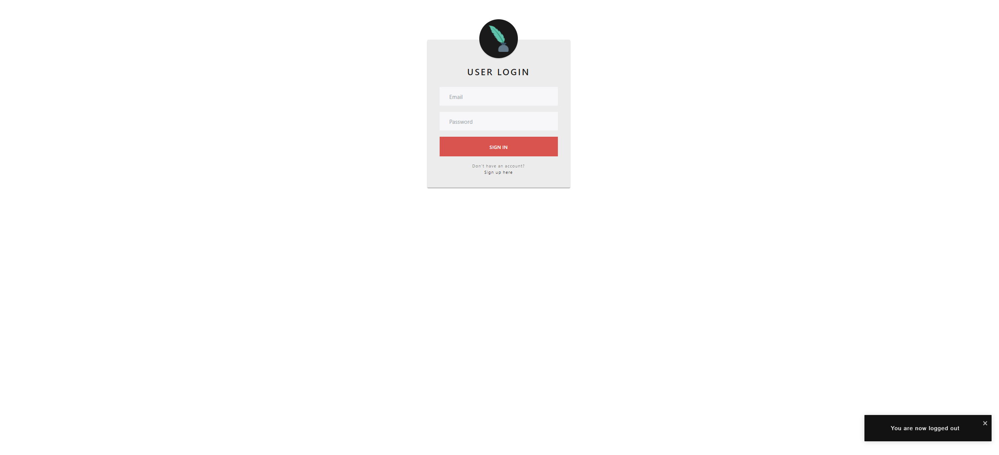
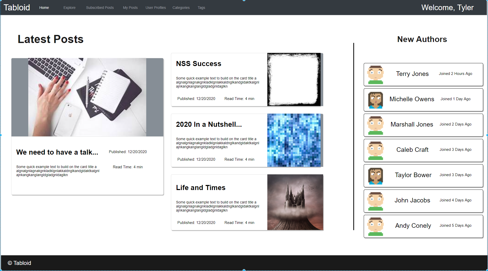
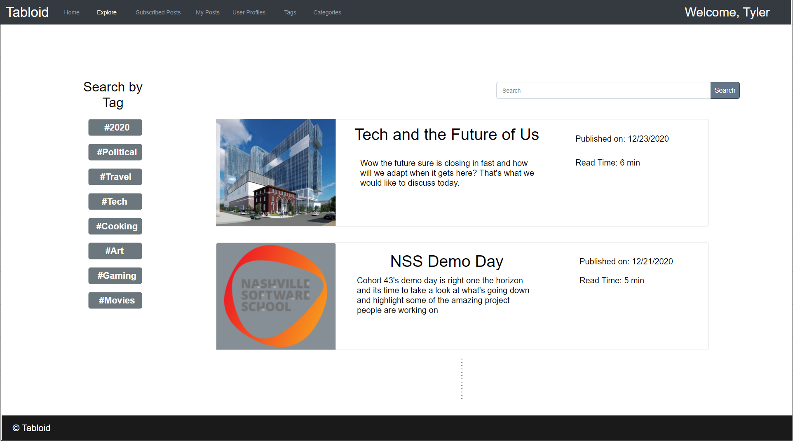
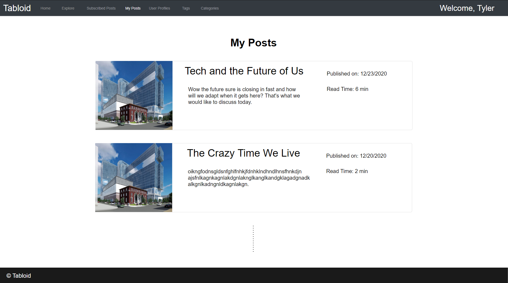
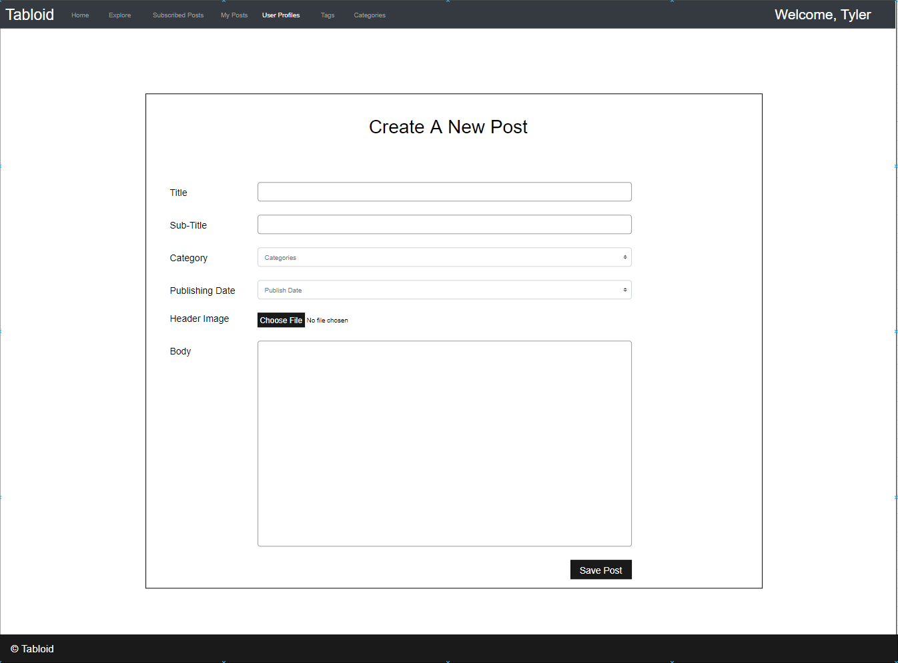
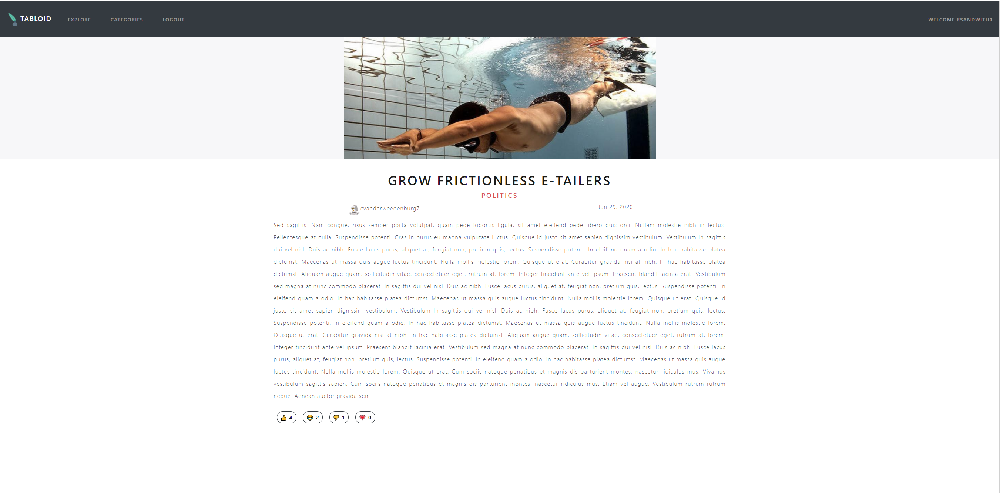
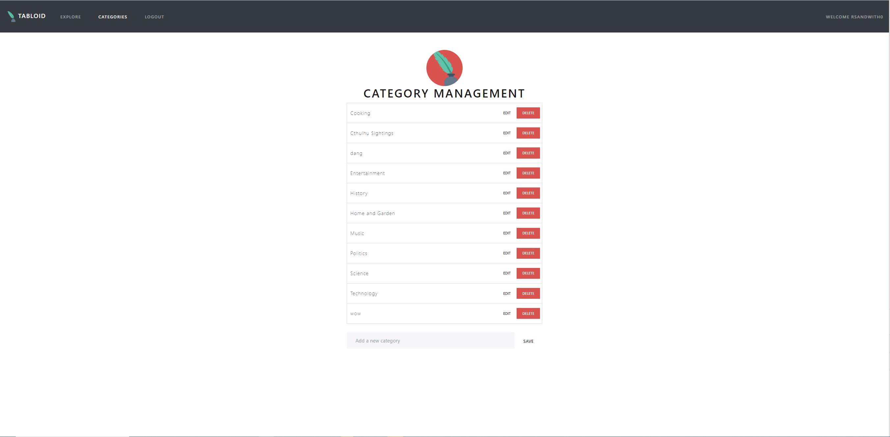

# Tabloid Full Stack Group Project

For this group project, you will be building an online content management system for anyone who would like to create an account and publish article on the Web for public consumption.

## Setup

This repository is the API for your project. Your team also has a separate client repository with the React code. Set up this API first, then follow the setup steps in the client repository's README.

This project targets .NET 10.

1. In the top-level directory of the cloned project on your computer, run `dotnet user-secrets init`
1. Run `dotnet user-secrets set AdminPassword password` (you can choose a different password if you wish)
1. Run `dotnet user-secrets set TabloidDbConnectionString 'Host=localhost;Port=5432;Username=postgres;Password=password;Database=Tabloid'`
1. Run `dotnet restore`
1. Run `dotnet build`
1. Run `dotnet tool update --global dotnet-ef`. The `dotnet-ef` tool version is tracked separately from the SDK, so without this step every `dotnet ef` command may warn that the tools are older than the runtime.
1. Run `dotnet ef migrations add InitialCreate`
1. Run `dotnet ef database update`

## Test the Setup

1. Start debugging the API. Swagger should open in your browser. It won't list any endpoints yet, because building them is your team's job.
1. In your client repository, run `npm install` and then `npm run dev`.
1. If the setup succeeded, you should see the Tabloid navbar and a welcome message.

## Seeded Users

The database is seeded with these users. Every one of them has the password you set as `AdminPassword` in your user-secrets. The first two are admins.

| Email | User name | Admin |
|---|---|---|
| `admina@strator.comx` | Administrator | Yes |
| `john@doe.comx` | JohnDoe | Yes |
| `jane@smith.comx` | JaneSmith | No |
| `alice@johnson.comx` | AliceJohnson | No |
| `bob@williams.comx` | BobWilliams | No |
| `Eve@Davis.comx` | EveDavis | No |

> **NOTE:** Every new migration you create will include `UpdateData` calls for the seeded users' `PasswordHash` column. This is expected. The hash is generated from your `AdminPassword` secret with a random salt each time the project builds, so EF Core always sees it as changed.

## Mock-Ups

The company has hired a designer and here are the mock-ups they provided.

> **NOTE:** Styling should **_NOT_** be prioritized over functionality. UI/UX **is** important, but it's more important that you focus on the code.

> **NOTE:** (The quill logo seen in some of the mockups is provided for you inside of the images folder along with the other mock-ups to use as needed!)

### Colors

These are the hex codes for the colors used in the mockups

* Red: `#db534b`
* Grey: `#6c767d`
* Black: `#343a40`
* Green: `#5bb8a6`

### Login Page

### Home Page

### Explore Page

### Your Post's Page

### Create Post Form

### Post Details Page

### Category List Page

